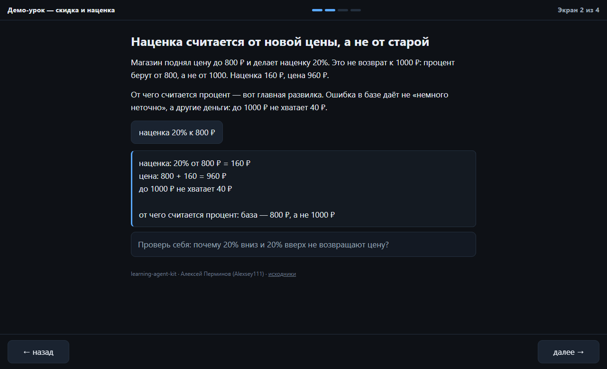
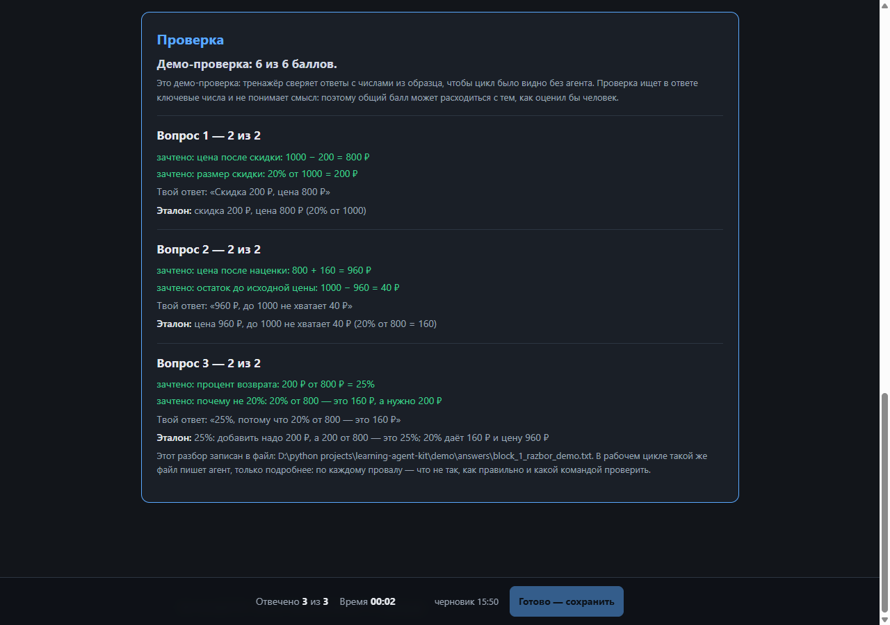

# Набор для обучения с проверкой: агент ведёт, тренажёр измеряет

Это не курс и не чат с ИИ. Это рабочая папка, по которой агент (Hermes, Claude Code, любой
агент с терминалом и доступом к файлам) строит человеку персональную программу обучения
и проверяет, что он действительно научился, а не «прошёл глазами».

Два участника, роли разные и не пересекаются:

- **агент** — собирает диагностику, план тем, уроки, блоки вопросов, ключи с эталонами,
  независимые оракулы для чисел и разборы; следит за гейтами (проверками) и ведёт файлы;
- **ученик** — читает урок в браузере, отвечает на вопросы блока, получает разбор и работает
  с тем, что не понял.

Всё состояние — обычные файлы на диске. Тренажёр локальный, слушает 127.0.0.1, в интернет
ничего не отправляет. Ни аккаунтов, ни облака, ни базы данных.

---

## 1. Попробовать за 5 минут — без агента и без своей темы

Сначала потрогать. В наборе есть демо: маленькая тема «скидка и наценка» — урок на четыре
экрана, блок из трёх вопросов и проверка прямо в браузере. Ни анкеты, ни агента, ни настройки.

1. Скачать папку: на странице репозитория зелёная кнопка **Code → Download ZIP**, распаковать.
2. Проверить Python: `Win+R` → `cmd` → `python --version`. Должно ответить `Python 3.10…`
   или новее. Если «python не найден» — поставить с python.org, отметив при установке
   «Add python.exe to PATH».
3. Двойной клик по `start.cmd`. Откроется чёрное окно (его не закрывать) и браузер с уроком.
4. Пройти четыре экрана — на каждом есть кнопка, которая считает числа. Нажать «к блоку»,
   ответить на три вопроса и нажать «Готово — сохранить».
5. Сразу под кнопкой появится проверка: сколько баллов, что зачтено, чего не хватило и
   какой эталон.

Вот как это выглядит — экран демо-урока и проверка после «Готово»:





Всё. Это и есть цикл: тренажёр записал ответы → ключ их сверил → разбор сказал, чего не
хватает. В папке `demo/answers/` появятся два файла: `block_1_answers.txt` (твои ответы)
и `block_1_razbor_demo.txt` (разбор). Открой их блокнотом: агент в рабочем цикле читает
и пишет ровно такие же файлы.

Что здесь упрощено: в демо проверку делает сам тренажёр, по списку ключевых чисел. Он видит
числа, но не видит смысл. В рабочем цикле ответы читает агент по ключу с эталонами и пишет
разбор словами: по каждому провалу — что не так, как правильно, какой командой проверить.
Пример такого разбора лежит в `demo/gaps/block_1_razbor_example.txt`.

Закрыть тренажёр: `Ctrl+C` в чёрном окне или просто закрыть окно. Linux / macOS:
`python3 trainer/trainer.py --study demo`.

`start.cmd` понимает имя папки: `start.cmd demo` — демо, `start.cmd study` — своя тема.
Без аргумента сначала берётся `demo`, затем `study`, затем `study_example`.

---

## 2. Своя тема: что сказать агенту (тот шаг, которого не хватало)

Дальше нужен агент: он собирает уроки, блоки и разборы. Агент — это программа с терминалом
(Hermes, Claude Code, любой другой). Работает она в папке набора и читает два файла:
`AGENT_BRIEF.md` (как вести цикл) и `INTAKE.md` (анкета и первое сообщение).

Шесть шагов, по порядку:

1. **Поставить агента** — один раз. Claude Code: `npm install -g @anthropic-ai/claude-code`,
   затем `claude`. Hermes — по инструкции из репозитория hermes-agent. Если агент уже есть,
   сразу к шагу 2.
2. **Открыть папку набора в агенте.** В Проводнике зайти в папку набора → в адресной строке
   набрать `cmd` → Enter → в открывшемся окне набрать `claude` (или `hermes`). Агент должен
   стартовать в этой папке: тогда он видит `AGENT_BRIEF.md`, `INTAKE.md` и `study/`.
3. **Вставить первое сообщение** — дословно, заменив только свою тему:

       Прочитай AGENT_BRIEF.md и INTAKE.md в этой папке. Я хочу учиться: <своя тема>.
       Работай по брифу и начни с шага 0 из INTAKE.md: короткое объяснение и три вопроса.
       Файлы создавай в папке study/.

   Если темы пока нет, оставить как есть: «Я хочу учиться: не знаю, чего хочу». Агент задаст
   три вопроса — что нравится делать, сколько часов есть, что считать успехом — и предложит
   2–3 направления с ценой каждого. Выбирать не он должен.
4. **Ответить на три вопроса.** Дальше агент задаёт анкету порциями по 3–4 вопроса: это
   разговор на 10–15 минут, а не форма на 60 полей. «Не знаю» — нормальный ответ.
5. **Согласиться с планом.** Сначала агент говорит словами, что получится и чего не будет,
   и только после «да, так» пишет `study/INTAKE_filled.md`, `study/topic_plan.md` и
   `study/state.json`. Пока плана нет, блоков не будет — это не сбой, а порядок.
6. **Когда агент скажет «блок готов»** — запустить `start.cmd study`, пройти урок, ответить
   на блок, нажать «Готово» и написать агенту одну строку: «готово». Он прочитает
   `study/answers/block_1_answers.txt` и напишет разбор в `study/gaps/`.

Что важно понять: агент ничего не знает о тебе заранее. Всё о твоей теме он берёт из анкеты
и ответов, всё о твоих успехах — из файлов в `study/`. Поэтому `study/` нельзя удалять между
сессиями: это память курса. Если агент говорит «не вижу файлов» или «не могу» — короткая
таблица типовых поломок в `TRANSFER.md`.

---

## 3. Для чего это нужно

Обычное самообучение врёт само себе: прочитал главу — кажется, понял; посмотрел видео —
кажется, запомнил. Через неделю выясняется, что не осталось ничего. Здесь вместо ощущения
«кажется, понял» — короткий письменный ответ, ключ с эталонами и разбор.

Три правила, на которых всё держится:

1. **Ключ пишется до ответов.** Эталонные ответы и шкала (0 / 1 / 1.5 / 2 за вопрос) готовы
   раньше, чем ученик открывает вопросы. Иначе критерий подгоняется под написанное.
2. **Блок не спрашивает того, чего не было на экранах урока.** Проверяется паспортом
   покрытия: у каждого вопроса перечислено, что он спрашивает, у каждого экрана — чему учит
   и какой ручкой это можно потрогать. Навык, показанный только абзацем, не считается
   выученным.
3. **Гейты — шлюзы, а не советы.** Пока проверки красные, блок ученику не показывается:
   лучше отказать агенту, чем выдать несогласованный материал.

Числа и формы в ключе проверяет не автор, а отдельный скрипт-оракул: он считает то же самое
по определениям заново. На первом же блоке по тензорам так нашлась ошибка в ключе
(в правом нижнем углу `A @ B` стояло 16 вместо 11).

---

## 4. На чём это работает

| Слой | Чем сделан | Что даёт |
|---|---|---|
| Тренажёр | Python, только стандартная библиотека | страница вопросов, таймер, автосохранение, запись ответов в файл |
| Хранение | файлы: `state.json`, `current.txt`, `answers/`, `keys/`, `gaps/` | видно глазами, можно проверить руками, ничего не теряется |
| Агент | Hermes / Claude Code / любой агент с терминалом | собирает программу, уроки, блоки, ключи, разборы |
| Контроль | 6 гейтов на Python | ловят расхождения между планом, уроком, блоком, ключом и разбором |
| Урок | HTML-страница с живыми ручками | не «текст про тензоры», а кнопки, которые считают на месте |

Гейты (`scripts/`, каждый сам проверяет себя на посаженных дефектах):

| Гейт | Что проверяет |
|---|---|
| `selftest.py` | пакет цел: файлы, парсер, ключ, живой прогон тренажёра, демо-проверка, `start.cmd` в CRLF без табуляции |
| `speccheck.py` | файлы цикла по брифу: блок, ключ, уровни, «ключ до ответов», `state`, план тем |
| `coverage.py` | урок покрывает блок (паспорт `coverage.json`) |
| `programcheck.py` | цепочка анкета → план → тема → клетки → блок сходится |
| `numberscheck.py` | числа ключа воспроизводятся независимым оракулом |
| `razborcheck.py` | провалы разобраны, а на «не понял» есть другой заход, а не пересказ |

---

## 5. Установка

Нужен только Python 3.10 или новее. Всё остальное уже в папке.

Windows:

1. Скачать папку (или `git clone`) и распаковать. Путь без пробелов предпочтительнее.
2. Проверить Python: открыть `cmd`, набрать `python --version` — должно ответить
   `Python 3.10...` и выше. Если «не найден» — поставить с python.org и при установке
   отметить «Add python.exe to PATH».
3. Двойной клик по `start.cmd`. Откроется окно консоли и браузер с уроком (или с блоком,
   если урок уже пройден).

`start.cmd` принимает папку данных: `start.cmd study_example`. Без аргумента берёт `demo`,
если он есть, иначе `study`, иначе `study_example`.

Linux / macOS:

```
python3 trainer/trainer.py --study demo
```

Опции: `--study <папка>`, `--port <порт>` (по умолчанию 8765, при занятом берёт следующий
из диапазона 8765–8776), `--no-browser`.

---

## 6. Порядок взаимодействия: агент и ученик

Подробный разговор с агентом — в разделе 2. Как это выглядит дословно, с репликами —
`examples/intake_demo.md`; правило простое: агент спрашивает порциями по 3–4 вопроса, а на
«не знаю» не повторяет вопрос, а предлагает две-три двери с ценой каждой и даёт выбрать.

Первая настройка (один раз: агент спрашивает, ученик отвечает):

| Шаг | Кто | Что происходит | Чем заканчивается |
|---|---|---|---|
| 0 | агент | первое сообщение: что будет происходить, и три вопроса — зачем, что уже пробовал, сколько часов в неделю | разговор, файлов ещё нет |
| 1 | ученик и агент | анкета `INTAKE.md` порциями по 3–4 вопроса: направление, время, фон, формат замеров | `study/INTAKE_filled.md` |
| 2 | агент | собирает диагностику по направлению (25–30 вопросов) и ключ к ней | `study/gaps/`, `diagnostic_report.txt` |
| 3 | агент | строит план на 3–6 тем: зачем тема, сколько сессий, какие клетки закрываются, чем измеряется | `study/topic_plan.md` + `state.json` |
| 4 | агент | прогоняет `programcheck.py`: план и состояние обязаны сходиться | зелёный гейт |

Цикл одной сессии (повторяется):

| Шаг | Кто | Что происходит | Чем заканчивается |
|---|---|---|---|
| 1 | агент | готовит урок по теме: 5–7 экранов, на каждом живая ручка; параллельно паспорт покрытия | `study/web/lesson.html`, `coverage.json` |
| 2 | агент | готовит блок: 3–8 вопросов, ключ со шкалой, оракул для чисел; прогоняет `coverage` и `numberscheck` | `current.txt`, `keys/` |
| 3 | ученик | запускает `start.cmd`, читает урок, переходит к блоку и отвечает | `answers/block_N_answers.txt` |
| 4 | агент | проверяет по ключу, считает сумму и охват, пишет разбор: на каждый провал — что не так, как правильно, шаг проверки | `gaps/block_N_razbor.txt` |
| 5 | ученик | читает разбор; если не понял — говорит «не понял» | — |
| 6 | агент | второй заход: другой способ объяснения плюс задача по шагам (не пересказ первого разбора) | `gaps/block_N_razbor_2.txt` |
| 7 | агент | ставит провалы в очередь повторов: +3 сессии и +10, поднимает `session` в `state.json` | `state.json` |

Ещё раз «не понял» — третий уровень: минимальные шаги без терминов и возврат в урок
на конкретный экран; дальше по программе не идём, меняется носитель.

Что важно знать ученику:

- «не знаю» — нормальный ответ, он ничего не портит: требовать ответа на то, чего не
  объясняли, — ошибка агента, а не ученика;
- игра балла не даёт: она показывает догадку, а не измеряет;
- между блоками минимум сутки; одна сессия = один вход в компьютер, не календарный день.

---

## 7. Что внутри

```
AGENT_BRIEF.md          главная инструкция агенту: роль, фазы 0–7, инварианты, форматы
INTAKE.md               анкета ученика + первое сообщение агента (шаг 0)
TRANSFER.md             передача другому агенту, чек-лист приёмки, типовые поломки
README.md               этот файл

skills/                 та же процедура в форме скиллов (по папке на скилл)
  01-direction-diagnostic  диагностика по направлению и ключ к ней
  02-learning-cycle        цикл сессий: блоки, ключи, возвраты, state, разбор, «не понял»
  03-lessons-and-checks    уроки и приборы с проверкой сразу
  04-kit-acceptance        приёмка пакета, развёртывание, поломки
  05-zero-start            режим «с нуля»: урок 0, игра, первые блоки

templates/              скелеты: state, блок, ключ, план тем, правила цикла, разбор,
                        разбор с углублением, паспорт покрытия

trainer/                локальный тренажёр: trainer.py + страницы блока, урока, игры
                        selfcheck.py — демо-проверка ответов по keys/block_N_check.json
scripts/                шесть гейтов (см. таблицу выше)

demo/                   демо-инстанс «скидка и наценка»: урок на 4 экрана, блок из 3 вопросов,
                        ключ, машинный образец для проверки в браузере, пример разбора
study_example/          рабочий пример: Python-junior, блок + ключ + state
study/                  живой пример: Godot для школьника — урок 0, игра, блок с рубрикой
study_tensors/          пример-проба: тензоры для нейросетей, 7 экранов, блок, оракул
examples/               примеры другого направления (QA) и диалог анкеты
start.cmd               запуск на Windows (CRLF!): без аргумента — demo, с аргументом — папка
```

Папка данных (её создаёт агент под ученика; примеры — `demo/`, `study_example/`):

```
state.json      сессия, тема, очередь повторов, клетки, история
current.txt     текущий блок: заголовок, секции ===, вопросы "N. ..."
INTAKE_filled.md, topic_plan.md
keys/           block_N_key.txt (эталоны и шкала), block_N_oracle.md (чем проверены числа)
                block_N_check.json — только у демо: машинный образец для проверки в браузере
answers/        block_N_answers.txt — то, что написал ученик
gaps/           разборы, диагностика, отчёты
web/            урок и игра этого инстанса
coverage.json   паспорт покрытия: экраны ↔ вопросы
oracle/         скрипты независимого расчёта чисел
```

---

## 8. Чек-лист приёмки (10 минут, один раз)

```
python scripts/selftest.py
python scripts/speccheck.py
python scripts/coverage.py      --study study
python scripts/programcheck.py  --study study
python scripts/numberscheck.py  --study study
python scripts/razborcheck.py   --study study
```

Все шесть должны быть зелёными. Гейт, который не умеет краснеть на посаженном дефекте, —
декоративный; поэтому каждый прогоняет свои контроли сам и печатает «пойман» по каждому.
Демо проверяется тем же способом: `python scripts/speccheck.py --study demo` и
`python scripts/coverage.py --study demo` — но помни, что в демо три вопроса после урока,
а не полный блок на 6–8.

---

## 9. Если что-то не работает

| Симптом | Причина | Что делать |
|---|---|---|
| двойной клик по `start.cmd` — окно мигает и закрывается | Python не в PATH | `python --version` в cmd; поставить Python с галочкой «Add to PATH» |
| в браузере «не удалось получить доступ к сайту» | сервер закрыт (окно консоли закрыли) | запустить `start.cmd` снова и обновить вкладку: страница сама пишет «Сервер тренажёра закрыт» |
| «Нет такой папки данных: study» | нет папки инстанса | `start.cmd study_example` или попросить агента создать `study/` |
| порт занят | другой тренажёр уже запущен | закрыть старое окно консоли; иначе тренер сам возьмёт следующий порт |
| ответы не сохранились | закрыли вкладку до «Готово» | черновик пишется сам, но итог — только по кнопке |
| после «Готово» нет проверки | это не демо-инстанс: проверяет агент | сказать агенту «готово»; проверка внутри страницы бывает только при `keys/block_N_check.json` |
| агент не видит файлы | он открыт не в той папке | открыть в агенте корень набора — там лежит `AGENT_BRIEF.md` |

---

## 10. Чего здесь нет и почему

- **Нет готовой базы вопросов «на все направления»**: такая база устаревает и привязывает
  к предмету. Есть процедура, как собрать вопросы под конкретную роль.
- **Нет календаря и напоминаний**: машина ученика может быть выключена; повторение живёт
  в нумерации сессий, а не в датах.
- **Нет облака и аккаунтов**: ответы лежат файлами рядом — их видно и можно проверить руками.
- **Нет мобильной версии**: страница адаптируется до 390 px, но запуск требует компьютера.
- **Нет проверки смысла без агента**: демо сверяет числа, а не формулировки. Смысл читает
  агент по ключу — это и есть его работа.

## 11. Статус

Рабочий инструмент, а не продукт: собирается под конкретного человека и его задачу.
Лучше всего работает там, где ответ можно проверить — числа, формы, команды, формулировки
правил. Для тем без проверяемого ответа (эссе, устная речь) нужен другой ключ — с рубрикой
вместо эталона; это отдельная работа, подробнее — в `AGENT_BRIEF.md`.

## 12. Лицензия

MIT — можно брать, менять, использовать в своих проектах и коммерчески, при условии, что
в копиях остаётся строка об авторе: `LICENSE`, файл `LICENSE` в репозитории, автор —
Алексей Перминов (Alexsey111). Уроки, игры и страницы блоков, собранные этим набором,
содержат подпись внизу страницы — она и есть исполнение условия в интерфейсе.

Канонический репозиторий: https://github.com/Alexsey111/learning-agent-kit
